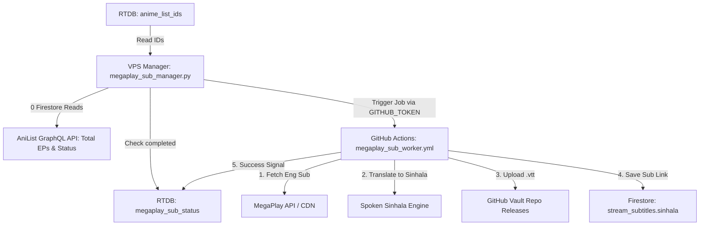

# 🎬 AniShift MegaPlay Subtitle Bot & Cloud Worker System

A high-performance, cost-effective subtitle automation engine for AniShift.
Automatically extracts MegaPlay English WebVTT subtitles, accurately translates them to **natural spoken Sinhala (කටවහර)** using Google Neural Translation + Anime Spoken Dictionary, uploads `.vtt` tracks to permanent GitHub Releases, and links them directly to episode documents.

---

## 🏗️ Architecture



---

## 🔑 GitHub Repository Secrets Configuration

When you create the GitHub repository for the Cloud Worker (e.g., `vinothgeethika/anishift-megaplay-sub-worker`), go to:
**Settings ➔ Secrets and variables ➔ Actions ➔ New repository secret** and add the following 4 secrets:

| Secret Name | Value | Purpose |
| :--- | :--- | :--- |
| `FIREBASE_JSON` | Content of `serviceAccountKey.json` | Used by the Cloud Runner to authenticate with Firestore & RTDB. |
| `FIREBASE_DB_URL` | `https://anishift-5d14b-default-rtdb.firebaseio.com/` | Realtime Database URL for emitting job completion signals. |
| `SUB_GITHUB_TOKEN` | Personal Access Token (`ghp_...`) | Write token to create GitHub releases and upload `.vtt` assets. |
| `SUB_GITHUB_REPO` | `Anishift-svr/sub-vault-160633` | Vault repository where subtitle files are hosted. |

---

## 💻 Local / VPS Manager Setup (`.env`)

Inside `megaplay_sub_bot/.env`:

```env
# GitHub Dispatch Configuration
GITHUB_TOKEN=your_github_personal_access_token_here
GITHUB_WORKFLOW_REPO=vinothgeethika/anishift-megaplay-sub-worker

# Vault Repo for Releases
GITHUB_REPO=Anishift-svr/sub-vault-160633

# Firebase Config
FIREBASE_DB_URL=https://anishift-5d14b-default-rtdb.firebaseio.com/

# Concurrency
MAX_CONCURRENT_JOBS=15
```

### Running the Manager:
```bash
pip install -r requirements.txt
python megaplay_sub_manager.py
```
